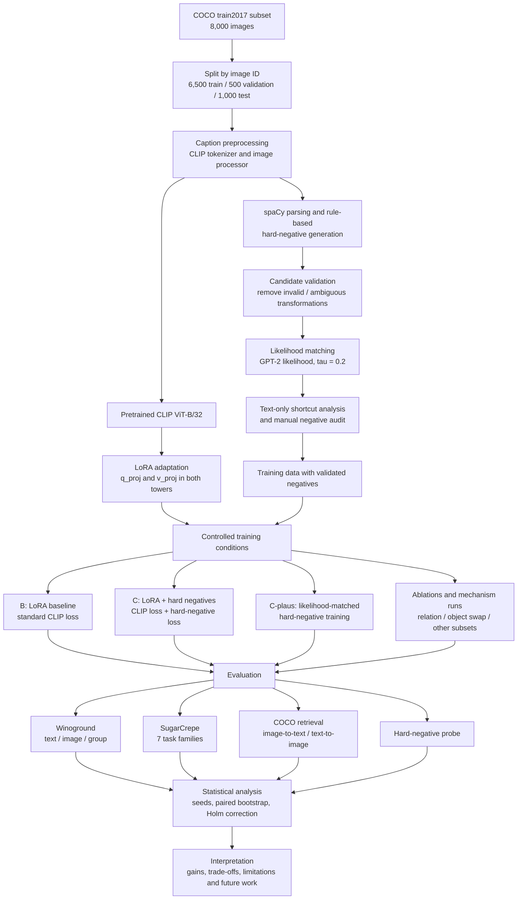

# Compositional Failures in CLIP: Improving Attribute-Object Binding via Hard-Negative Fine-Tuning

**Foundations of Generative AI — Lab Project**

**Team**
- **V. Praveen**
- **B. Manikanta**

**Repository:** https://github.com/9raveen/Clip-Compositionality-FGAI  
**Primary model:** CLIP ViT-B/32  
**Fine-tuning:** LoRA (Parameter-Efficient Fine-Tuning)  
**Training data:** COCO train2017 subset  
**Primary benchmark:** Winoground  
**Secondary benchmark:** SugarCrepe  
**Training environment:** Google Colab, NVIDIA T4 GPU

---

## Abstract

Vision-language models such as CLIP learn a shared representation space for images and text, enabling image–text matching and retrieval. However, recognizing the objects and attributes mentioned in a caption does not guarantee that a model understands how those concepts are composed. For example, *“a dog chasing a cat”* and *“a cat chasing a dog”* contain the same objects but describe different relationships.

This project investigates whether structured hard-negative fine-tuning can improve CLIP's sensitivity to compositional changes. We generate five types of hard negatives from COCO captions—attribute replacement, object replacement, relation replacement, object swapping, and attribute swapping—and fine-tune CLIP ViT-B/32 using LoRA. The proposed objective combines the standard symmetric CLIP contrastive loss with a pairwise ranking loss that encourages an image to score its positive caption above a generated negative caption.

We evaluate the resulting models on Winoground, SugarCrepe, COCO image–text retrieval, and an in-distribution hard-negative probe. The results are mixed: the full hard-negative model improves two pre-planned SugarCrepe task comparisons after Holm correction, but its Winoground text score is lower than the standard fine-tuning baseline. Additional mechanism runs show that `obj_swap`-only training improves SugarCrepe `swap_obj` while lowering Winoground text accuracy. Text-only diagnostics reveal that some generated negative categories contain strong linguistic cues. These findings caution against interpreting improved synthetic-negative discrimination as proof of general visual compositional understanding.

---

## 1. Introduction

CLIP (Contrastive Language–Image Pre-training) uses an image encoder and a text encoder to map visual and textual inputs into a shared embedding space. Similarity between an image embedding and a caption embedding can then be used for image–text matching and retrieval.

A key limitation investigated in this project is **compositionality**: the ability to understand how individual concepts are combined and related.

Examples:

| Correct caption | Hard negative | Transformation |
|---|---|---|
| A red car is parked. | A green car is parked. | Attribute replacement |
| A dog runs across the grass. | A cat runs across the grass. | Object replacement |
| A cup is on the table. | A cup is under the table. | Relation replacement |
| A dog chases a cat. | A cat chases a dog. | Object swap |
| A red car beside a blue bicycle. | A blue car beside a red bicycle. | Attribute swap |

A model may recognize *dog*, *cat*, *red*, and *blue* without reliably understanding which object has which attribute or which entity performs an action.

We investigate whether training on semantically close but incorrect captions helps CLIP distinguish these subtle differences.

## 2. Problem Statement and Research Question

**Problem statement:** CLIP can perform broad image–text alignment while still failing to distinguish captions that contain similar words but encode different object roles, attributes, or relationships.

**Research question:** Does fine-tuning CLIP with structured hard-negative captions improve its ability to rank a correct caption above a semantically similar but incorrect caption, and do such gains transfer to independent compositional benchmarks?

### Experimental hypotheses

1. Hard-negative supervision may improve discrimination between positive captions and carefully constructed negative captions.
2. The type of hard negative may influence which benchmark task improves.
3. Linguistic artifacts in synthetic negatives may let a model distinguish labels without examining the image.
4. Better performance on generated negatives may not transfer to broader compositional reasoning.

---

## 3. Project Workflow

The following diagram summarizes the complete data, training, evaluation, and analysis pipeline.



### High-level stages

1. Prepare image-ID-disjoint COCO splits.
2. Parse captions and generate structured hard negatives.
3. Validate candidate negatives and investigate linguistic shortcuts.
4. Adapt pretrained CLIP using LoRA.
5. Train baseline, hard-negative, likelihood-matched, and ablation conditions.
6. Evaluate on Winoground, SugarCrepe, COCO retrieval, and the hard-negative probe.
7. Aggregate seeds, estimate uncertainty, apply multiple-comparison correction, and interpret results.

---

## 4. Dataset and Data Preparation

### 4.1 MS COCO

We use a random subset of **COCO train2017**. COCO contains natural images with human-written captions describing objects and scenes.

The selected 8,000 images are split by **image ID**, ensuring that captions from the same image cannot cross between training, validation, and test splits.

| Split | Images | Captions per image | Caption count |
|---|---:|---:|---:|
| Train | 6,500 | 3 | 19,500 |
| Validation | 500 | 2 | 1,000 |
| Test | 1,000 | 5 | 5,000 |
| **Total** | **8,000** | — | — |

The split is recorded in `data/splits.json` and checked by `scripts/prepare_coco_subset.py`.

### 4.2 Leakage prevention

- COCO `val2017` is not used for training or tuning because SugarCrepe is built using COCO `val2017`.
- Winoground and SugarCrepe are not used to generate training negatives or select the loss weight, epoch count, or final checkpoint.
- Final-epoch checkpoints are evaluated.
- The COCO retrieval test split comes from the same broad dataset distribution as training; retrieval results therefore partly reflect COCO-domain adaptation.

### 4.3 Preprocessing

- Images are processed using the pretrained CLIP image processor.
- Captions are tokenized using the CLIP tokenizer.
- Captions are associated with their corresponding image IDs.
- The split is performed at image level rather than caption-row level.
- spaCy is used to identify linguistic structures for negative generation.

---

## 5. Hard-Negative Generation

Hard negatives are incorrect captions that remain lexically or semantically close to the original caption. They make the matching task more challenging than using unrelated captions.

We use rule-based transformations implemented with spaCy.

| Type | Example transformation | Intended change |
|---|---|---|
| `attr_replace` | red car → green car | Change an attribute |
| `obj_replace` | dog → cat | Replace an object |
| `rel_replace` | on → under | Change a relation |
| `obj_swap` | dog chases cat → cat chases dog | Swap subject/object roles |
| `attr_swap` | red car + blue bicycle → blue car + red bicycle | Swap attributes across objects |

### 5.1 Candidate validation

Generated candidates pass validation checks intended to reject:

- Identical captions.
- Transformations that are not valid permutations.
- Symmetric relations where swapping does not change meaning.
- Same-noun swaps.
- Synonym replacements.
- Subject–verb or other agreement mismatches.
- Excessively complex or malformed transformations.

These checks improve the quality of generated candidates, but they cannot establish whether a caption is actually false for its image. Image-level auditing is therefore important.

### 5.2 Negative coverage

The following counts are from the training set of 19,500 captions. Categories can overlap, so the rows should not be summed to obtain the number of unique captions.

| Negative type | Captions with a validated negative | After likelihood matching (`tau = 0.2`) |
|---|---:|---:|
| `obj_replace` | 10,162 (52.1%) | 5,500 (54.1% kept) |
| `rel_replace` | 7,870 (40.4%) | 999 (12.7% kept) |
| `obj_swap` | 7,689 (39.4%) | 594 (7.7% kept) |
| `attr_replace` | 5,718 (29.3%) | 3,442 (60.2% kept) |
| `attr_swap` | 251 (1.3%) | 189 (75.3% kept) |
| **At least one type** | **15,922 / 19,500 (81.7%)** | **8,638 (44.3%)** |

**Important limitation:** `attr_swap` examples are sparse. Only 251 training captions have a validated attribute-swap negative, and only 189 remain after likelihood matching. Therefore, the project does not establish a general improvement in attribute–object binding.

---

## 6. Challenges and Shortcut Analysis

### 6.1 Negative validity

A generated caption can be grammatically valid but still describe the image correctly. Treating such a caption as false introduces label noise.

The rule-based validation stage reduces obvious errors, but image-level manual review is needed to estimate how often the generated captions are genuinely false.

### 6.2 Linguistic shortcuts

A model may distinguish positive and negative captions using wording patterns rather than visual evidence.

For example, if a relation word such as `under` appears far more frequently in negative captions, the model may learn a text-only association.

In the relation-replacement data, `under` appears in 6,753 negative captions and 221 positive captions.

### 6.3 GPT-2 likelihood analysis

GPT-2 likelihood is used as a proxy for linguistic plausibility. Before filtering, GPT-2 assigns a lower likelihood to the negative than to the positive:

- `obj_swap`: 97.8% of pairs.
- `rel_replace`: 95.4% of pairs.

### 6.4 Text-only classifier

A unigram-plus-bigram classifier is trained on training pairs and evaluated on validation pairs. It achieves:

- `obj_swap`: 93.0%.
- `rel_replace`: 96.0%.

Since this classifier receives text only, these scores show that the generated captions contain strong linguistic cues that can reveal the negative label without image information.

### 6.5 Likelihood matching

We apply GPT-2 likelihood matching with threshold `tau = 0.2` to make positive and negative captions more comparable in linguistic plausibility.

This reduces, but does not eliminate, shortcut signals:

- GPT-2 likelihood comparison after filtering: 70.6% for `obj_swap`, 80.6% for `rel_replace`.
- Learned text-only detector after filtering: 95.0% on 20 `obj_swap` validation pairs and 91.1% on 45 `rel_replace` validation pairs.

The post-filter validation counts are small. We therefore treat these values as diagnostic evidence, not precise population estimates.

### 6.6 Manual negative audit

The audit script samples 40 negatives per type. The label convention is:

- `1`: caption is clearly false for the image (valid negative).
- `0`: caption could be true, is ambiguous, or is ungrammatical.

The mechanism-run notes report:

| Type | Manually audited valid-negative precision |
|---|---:|
| `obj_swap` | 90% |
| `rel_replace` | 55% |

The available final handoff records these two category-level values. No precision value is stated here for the other three categories rather than inventing one. The audit script is `scripts/audit_negatives.py`.

---

## 7. Model Architecture and Methodology

### 7.1 Base model: CLIP ViT-B/32

CLIP contains two encoders:

- **Vision encoder:** maps an image to an image embedding.
- **Text encoder:** maps a caption to a text embedding.

The embeddings are normalized and compared using cosine-style similarity:

\[
s(I,T)=\frac{v_I^\top v_T}{\|v_I\|\|v_T\|}
\]

A higher score indicates stronger image–text compatibility according to the model.

### 7.2 LoRA fine-tuning

We use Low-Rank Adaptation (LoRA) to adapt the pretrained model efficiently rather than updating all model parameters.

The low-rank update is:

\[
W' = W + \frac{\alpha}{r}BA
\]

where `W` is the original weight matrix and `A` and `B` are trainable low-rank matrices.

LoRA is applied to `q_proj` and `v_proj` in both the vision and text towers.

| Parameter | Setting |
|---|---|
| Base model | CLIP ViT-B/32 |
| LoRA rank (`r`) | 16 |
| LoRA alpha (`alpha`) | 32 |
| LoRA dropout | 0.05 |
| Target modules | `q_proj`, `v_proj` |
| Adapted towers | Vision and text |
| Trainable parameters | 983,040 |
| Fraction of model parameters | 0.65% |

### 7.3 Standard CLIP contrastive loss

For a batch of `N` image–caption pairs, CLIP forms an image–text similarity matrix. Matching pairs should have higher similarity than mismatched pairs.

The standard objective is symmetric:

\[
\mathcal{L}_{CLIP} =
\frac{1}{2}
\left(
\mathcal{L}_{I\rightarrow T}+
\mathcal{L}_{T\rightarrow I}
\right)
\]

The two directions train image-to-text and text-to-image matching.

### 7.4 Hard-negative ranking loss

For an image `I`, let `T+` be its positive caption and `T-` its generated negative caption.

\[
s_{pos}=s(I,T^+), \qquad s_{neg}=s(I,T^-)
\]

The hard-negative objective encourages:

\[
s_{pos} > s_{neg}
\]

The implemented loss is:

\[
\mathcal{L}_{HN} =
-\log \sigma\left(
\text{scale}\cdot(s_{pos}-s_{neg})
\right)
\]

### 7.5 Combined objective

\[
\boxed{
\mathcal{L}_{total} =
\mathcal{L}_{CLIP}+
\lambda\mathcal{L}_{HN}
}
\]

The main experiment uses `lambda = 1.0`, fixed in advance. Sensitivity runs use `lambda = 0.5` and `lambda = 2`.

The standard CLIP loss is retained to preserve broad image–text alignment while the additional ranking loss encourages discrimination between a positive caption and a closely related negative caption.

---

## 8. Experimental Conditions and Training Configuration

### 8.1 Conditions

| Condition | Configuration | Purpose |
|---|---|---|
| A — `zeroshot` | Pretrained CLIP, no fine-tuning | Reference model |
| B — `lora_baseline` | LoRA + standard CLIP loss | Fine-tuning control |
| C — `lora_hn` | LoRA + CLIP loss + all validated hard negatives | Main proposed method |
| C-plaus — `lora_hn_plaus` | Same objective with likelihood-matched negatives | Investigate shortcut mitigation |
| Relation-only | `rel_replace` + `obj_swap` negatives | Combined relation-category ablation |
| Attribute-only | Attribute negatives | Attribute ablation |
| Object-only | Object negatives | Object ablation |
| `obj_swap`-only | Object-swap negatives only | Mechanism isolation |
| `rel_replace`-only | Relation-replacement negatives only | Mechanism isolation |
| Lambda ablations | `lambda = 0.5` and `lambda = 2` | Loss-weight sensitivity |

B and C use the same LoRA configuration, images, caption selection per image per epoch, and random seeds. Their primary difference is the training objective.

### 8.2 Training configuration

| Parameter | Value |
|---|---:|
| Learning rate | `1e-4` |
| Batch size | 128 |
| Epochs | 10 |
| Weight decay | 0.01 |
| Warm-up steps | 20 |
| Precision | FP16 |
| Main hard-negative weight | `lambda = 1.0` |
| Main seeds | 0, 1, 2 |

B, C, C-plaus, and the combined relation-only condition have three-seed results. The separate `obj_swap`-only and `rel_replace`-only mechanism runs have two seeds each and are exploratory. Most other ablations have one seed.

---

## 9. Evaluation Methodology

We use four complementary evaluation tracks.

### 9.1 Winoground — primary benchmark

Winoground contains 400 examples. Each example has two images and two captions designed to test compositional image–text matching.

It reports:

- **Text score:** whether each image prefers its correct caption.
- **Image score:** whether each caption prefers its correct image.
- **Group score:** whether both image and text conditions are correct.

Chance references are 25% for text, 25% for image, and approximately 16.7% for group.

### 9.2 SugarCrepe — secondary benchmark

SugarCrepe contains 7,511 examples across seven task families:

- `replace_obj`
- `replace_att`
- `replace_rel`
- `swap_obj`
- `swap_att`
- `add_obj`
- `add_att`

For each example, the model should rank the correct caption above the modified incorrect caption.

Because SugarCrepe is COCO-derived, comparisons should be made against the COCO-fine-tuned baseline B rather than relying only on the zero-shot reference.

### 9.3 COCO image–text retrieval

The held-out retrieval split contains 1,000 images and 5,000 captions.

We report Recall@1 for:

- Image-to-text retrieval.
- Text-to-image retrieval.

The retrieval test split is from the same broad dataset distribution as training, so the results partly reflect domain adaptation.

### 9.4 Hard-negative probe

The probe measures whether a model ranks the original caption above its generated negative on validation pairs.

It is an in-distribution diagnostic. Strong probe accuracy alone does not prove general compositional understanding, especially when a text-only classifier can distinguish the generated captions.

---

## 10. Results

### 10.1 Winoground and COCO retrieval

Main conditions are mean ± sample standard deviation over three seeds. The separate mechanism runs use two seeds.

| Condition | Winoground Text | Image | Group | i2t R@1 | t2i R@1 |
|---|---:|---:|---:|---:|---:|
| A — Zero-shot | 31.0 | 11.2 | 9.0 | 68.9 | 49.0 |
| B — Baseline | 33.9 ± 1.4 | 12.3 ± 1.8 | 8.7 ± 0.8 | 75.0 ± 0.9 | 60.0 ± 0.2 |
| C — All negatives | 29.4 ± 0.1 | 11.9 ± 0.5 | 8.0 ± 0.4 | 73.1 ± 0.2 | 59.7 ± 0.2 |
| C-plaus — Matched | 33.3 ± 1.0 | 12.0 ± 0.2 | 8.8 ± 0.4 | 72.8 ± 0.3 | 59.5 ± 0.4 |
| Relation-only (`rel_replace` + `obj_swap`) | 29.2 ± 0.3 | 12.3 ± 0.4 | 7.8 ± 0.2 | 71.9 ± 0.3 | 59.7 ± 0.1 |
| Attribute-only | 33.2 | 11.2 | 7.5 | 73.2 | 59.3 |
| Object-only | 34.0 | 11.2 | 8.0 | 73.3 | 59.5 |
| Lambda 0.5 | 30.8 | 12.8 | 8.0 | 73.9 | 60.1 |
| Lambda 2 | 28.2 | 11.8 | 8.2 | 71.5 | 59.5 |
| `obj_swap`-only (2 seeds) | 28.1 ± 0.5 | 12.4 ± 0.2 | 8.1 ± 0.5 | 73.9 ± 0.4 | 59.8 ± 0.1 |
| `rel_replace`-only (2 seeds) | 32.1 ± 0.2 | 12.0 ± 1.4 | 8.8 ± 1.4 | 73.6 ± 1.3 | 59.5 ± 0.1 |

**Primary Winoground comparison (B vs C):**

- C is lower than B on text score by 4.5 percentage points.
- Paired-bootstrap 95% CI: `[-7.75, -1.33]`.
- Holm-adjusted `p = 0.040`.
- No detectable improvement is established on Winoground image or group score.

**Mechanism runs:**

- `obj_swap`-only: 28.1 ± 0.5 text, a difference of `-6.38` points vs B; 95% CI `[-9.88, -2.88]`.
- `rel_replace`-only: 32.1 ± 0.2 text, a difference of `-2.38` points vs B; 95% CI `[-5.12, +0.25]`. This is smaller and inconclusive because the interval includes zero.
- These mechanism runs have two seeds each, are exploratory, and are not multiple-comparison corrected.
- The `obj_swap`-only text decrease is concentrated in the Winoground Object tag: `-12.8` points, CI `[-19.9, -6.0]` (exploratory).

The `obj_swap`-only run reproduces the Winoground text decrease, whereas the `rel_replace`-only run shows a smaller, inconclusive effect. The `obj_swap` audit precision is 90%, so label noise alone does not explain the observed decrease. The association with text-only cue learning is consistent with the evidence but was not tested directly as a causal mechanism.

### 10.2 SugarCrepe results

Accuracy (%). Main conditions are mean ± sample standard deviation over three seeds; the two mechanism runs have two seeds and are exploratory.

| Condition | replace_obj | replace_att | replace_rel | swap_obj | swap_att | add_obj | add_att | Mean |
|---|---:|---:|---:|---:|---:|---:|---:|---:|
| A — Zero-shot | 90.7 | 80.3 | 69.4 | 61.2 | 64.0 | 77.1 | 69.5 | 73.2 |
| B — Baseline | 94.2 ± 0.2 | 85.8 ± 1.2 | 69.3 ± 0.2 | 63.1 ± 0.6 | 69.2 ± 0.8 | 86.5 ± 0.4 | 78.0 ± 0.6 | 78.0 ± 0.2 |
| C — All negatives | 93.4 ± 0.3 | 86.3 ± 0.8 | 75.5 ± 0.3 | 68.2 ± 1.1 | 72.1 ± 0.9 | 85.6 ± 0.3 | 81.7 ± 1.0 | 80.4 ± 0.2 |
| C-plaus — Matched | 93.6 ± 0.2 | 86.8 ± 0.1 | 73.6 ± 0.5 | 66.5 ± 1.1 | 71.2 ± 0.5 | 86.8 ± 0.2 | 82.1 ± 1.1 | 80.1 ± 0.1 |
| Relation-only (combined) | 92.9 ± 0.1 | 85.1 ± 0.3 | 75.6 ± 0.6 | 68.6 ± 0.4 | 71.1 ± 0.6 | 83.5 ± 0.1 | 80.2 ± 1.1 | 79.6 ± 0.1 |
| Attribute-only | 93.5 | 86.7 | 70.3 | 66.5 | 71.6 | 85.4 | 82.1 | 79.4 |
| Object-only | 93.7 | 84.0 | 69.7 | 63.7 | 67.4 | 88.5 | 79.0 | 78.0 |
| `obj_swap`-only (2 seeds) | 93.0 ± 0.1 | 85.2 ± 0.5 | 69.8 ± 1.2 | 69.6 ± 2.0 | 71.0 ± 0.0 | 84.0 ± 0.2 | 83.1 ± 1.0 | 79.4 ± 0.4 |
| `rel_replace`-only (2 seeds) | 93.4 ± 0.1 | 83.8 ± 0.3 | 75.9 ± 0.1 | 63.9 ± 0.3 | 67.4 ± 1.1 | 84.5 ± 0.5 | 78.7 ± 0.9 | 78.2 ± 0.4 |

**Pre-planned comparisons surviving Holm correction:**

- C vs B on `replace_rel`: `+6.24` points, Holm `p = 0.002`.
- C vs B on `add_att`: `+3.66` points, Holm `p = 0.014`.
- C-plaus vs B on `replace_rel`: `+4.27` points, Holm `p = 0.002`.
- C-plaus vs B on `add_att`: `+4.09` points, Holm `p = 0.002`.
- C vs C-plaus on `replace_rel`: `+1.97` points, Holm `p = 0.022`.
- C vs C-plaus on `add_obj`: `-1.20` points, Holm `p = 0.020` (C is lower).

**Exploratory mechanism comparisons (two seeds, uncorrected):**

- `rel_replace`-only improves `replace_rel` by `+6.76` points vs B (95% CI `[+5.19, +8.36]`), but does not show a detectable `swap_obj` gain (`+0.82`, CI `[-3.06, +4.69]`).
- `obj_swap`-only improves `swap_obj` by `+6.53` points vs B (95% CI `[+0.61, +12.45]`), but does not show a detectable `replace_rel` gain (`+0.68`, CI `[-1.10, +2.42]`).
- `obj_swap`-only also shows an `add_att` gain of `+5.20` points (95% CI `[+3.03, +7.37]`).
- `rel_replace`-only has a `swap_att` difference of `-2.25` points (95% CI `[-4.28, -0.23]`).
- Most hard-negative variants lower `add_obj` by approximately 0.8–3.0 points; these mechanism comparisons are exploratory and uncorrected.

**Cross-benchmark observation:** `obj_swap`-only raises SugarCrepe `swap_obj` by about 6.5 points while lowering Winoground text by about 6.4 points. The same training operation moves the two benchmarks in opposite directions. This is evidence of a narrow, task-specific effect rather than a general compositionality improvement.

### 10.3 Hard-negative probe

Validation-pair accuracy (%), where the model must rank the original caption above its generated negative.

| Type (validation pairs) | Zero-shot | B | C | C-plaus |
|---|---:|---:|---:|---:|
| `attr_replace` (289) | 77.5 | 81.5 | 90.1 | 88.1 |
| `attr_swap` (12; too few to interpret) | 66.7 | 61.1 | 72.2 | 75.0 |
| `obj_replace` (542) | 89.1 | 93.8 | 95.8 | 95.4 |
| `obj_swap` (412) | 71.4 | 59.5 | 93.0 | 80.2 |
| `rel_replace` (425) | 60.9 | 61.7 | 95.5 | 91.9 |

The near-equality between C and the text-only classifier on `obj_swap` and `rel_replace` indicates that the generated probe contains substantial language-only signal. This is why probe accuracy must not be interpreted as independent proof of visual compositional reasoning.

### 10.4 Qualitative Winoground examples

Qualitative examples are selected using a fixed majority-of-seeds rule, not hand-picked after viewing the examples.

- An example is counted as correct for a condition when a majority of its three seeds are correct on the text score.
- Out of 400 examples, B is correct and C is incorrect on **34** examples.
- C is correct and B is incorrect on **20** examples.
- The figures show the first four examples in dataset order from each group.
- The figures display per-example correctness, not similarity scores.

Files:
- `figures/qualitative_text_lora_baseline_right_lora_hn_wrong.png`
- `figures/qualitative_text_lora_hn_right_lora_baseline_wrong.png`

### 10.5 Result interpretation

The experiments support a nuanced conclusion:

1. The full hard-negative model improves two pre-planned SugarCrepe task comparisons after Holm correction.
2. It does not improve Winoground; its text score is significantly lower than the baseline under the pre-planned comparison.
3. Mechanism runs show task-aligned SugarCrepe effects: relation replacement helps `replace_rel`, while object swapping helps `swap_obj`.
4. The `obj_swap`-only gain on SugarCrepe occurs alongside a Winoground text-score decrease.
5. Text-only diagnostics are consistent with shortcut learning, but the mechanism was not established through a direct causal test.
6. There is no evidence to claim a general improvement in attribute–object binding.

---

## 11. Statistical Analysis

- Main conditions report mean ± sample standard deviation across seeds.
- Paired bootstrap uses 10,000 resamples over evaluation examples, with differences averaged over seeds.
- A 95% confidence interval is reported for paired differences.
- Holm-adjusted p-values are used for the pre-planned comparisons: B vs C, B vs C-plaus, and C-plaus vs C (9 Winoground and 21 SugarCrepe tests).
- Ablation and per-tag analyses are exploratory and uncorrected.
- The separate `obj_swap`-only and `rel_replace`-only mechanism runs use two seeds each and are exploratory, uncorrected comparisons.

A result is not described as a general improvement merely because its point estimate is higher. We consider uncertainty, seed variability, benchmark scope, and multiple comparisons.

---

## 12. Software and Hardware Requirements

### Hardware used

- Google Colab GPU runtime.
- NVIDIA T4 GPU for the reported training experiments.
- Google Drive for persistent storage of datasets, logs, and model checkpoints.
- Sufficient temporary storage for COCO images and benchmark data.

### Software stack

The project uses the dependencies recorded in `requirements.txt`. The main tools include:

- Python
- PyTorch and torchvision
- Hugging Face Transformers and Datasets
- PEFT for LoRA
- spaCy and `en_core_web_sm`
- NumPy and pandas
- scikit-learn
- Matplotlib
- PyYAML
- Pillow and tqdm

Install dependencies using:

```bash
pip install -r requirements.txt
```

The notebook `colab_runner.ipynb` documents the Colab setup and experiment execution. Check the notebook before running the pipeline because dataset downloads, Drive paths, and branch settings must be configured for the active session.

---

## 13. Repository Structure

```text
Clip-Compositionality-FGAI/
├── configs/
│   ├── _base.yaml
│   ├── lora_baseline.yaml
│   ├── lora_hn.yaml
│   ├── lora_hn_plaus.yaml
│   ├── lora_hn_attr.yaml
│   ├── lora_hn_obj.yaml
│   ├── lora_hn_rel.yaml
│   ├── lora_hn_objswap.yaml
│   ├── lora_hn_relrep.yaml
│   └── ...
├── data/
│   └── splits.json
├── docs/
│   └── VIVA.md
├── figures/
│   ├── winoground.png
│   ├── sugarcrepe.png
│   ├── retrieval.png
│   ├── ablation.png
│   ├── probe.png
│   ├── loss_curves.png
│   └── qualitative_*.png
├── logs/
│   └── *.jsonl
├── results/
│   ├── summary.md
│   ├── summary.csv
│   ├── summary_per_seed.csv
│   ├── bootstrap.csv
│   └── *.json
├── scripts/
│   ├── prepare_coco_subset.py
│   ├── filter_plausible.py
│   ├── text_only_bias.py
│   ├── audit_negatives.py
│   ├── run_all.py
│   ├── probe_hn.py
│   ├── eval_sugarcrepe.py
│   ├── qualitative.py
│   ├── aggregate.py
│   └── visualize.py
├── src/
│   ├── model.py
│   ├── train.py
│   ├── negatives.py
│   ├── eval_winoground.py
│   ├── eval_retrieval.py
│   ├── evaluate.py
│   └── utils.py
├── colab_runner.ipynb
├── requirements.txt
└── README.md
```

Generated datasets and checkpoints may be stored on Google Drive rather than committed to Git. The exact files present in a checkout can vary by branch and commit.

---

## 14. Reproducing the Experiments

Open `colab_runner.ipynb`. Follow its setup cells at the start of each Colab session and configure the repository branch, Git identity, Drive paths, and dataset locations.

The documented pipeline is:

```bash
# 1. Prepare image-ID-disjoint COCO subset
python -m scripts.prepare_coco_subset

# 2. Generate training and validation negatives
python -m src.negatives

# 3. Create likelihood-matched negatives
python -m scripts.filter_plausible

# 4. Measure text-only shortcut signals
python -m scripts.text_only_bias

# 5. Run manual negative audit
python -m scripts.audit_negatives

# 6. Train main and ablation conditions
python -m scripts.run_all --tier main
python -m scripts.run_all --tier ablation

# 7. Evaluate hard-negative probe
python -m scripts.probe_hn

# 8. Evaluate SugarCrepe
python -m scripts.eval_sugarcrepe

# 9. Aggregate results and tags
python -m scripts.aggregate --tags

# 10. Generate figures
python -m scripts.visualize
```

The separate mechanism configurations are:
- `lora_hn_objswap`
- `lora_hn_relrep`

Use the exact command-line options and paths shown in the current notebook and each script's `--help` output. The commands above describe the pipeline order; dataset roots, output paths, and seed arguments may need to be supplied for a particular run.

Per-run results are stored in `results/*.json`; training logs are stored in `logs/*.jsonl`. Result files record the Git commit and configuration. Model checkpoints are stored on Drive and are not necessarily included in the repository.

---

## 15. Limitations and Deviations

1. **One base architecture:** Experiments use CLIP ViT-B/32 and one main LoRA configuration.
2. **Small primary benchmark:** Winoground contains 400 examples.
3. **Limited seeds for some runs:** Main conditions have three seeds, but `obj_swap`-only and `rel_replace`-only have two seeds; most other ablations have one seed.
4. **Exploratory mechanism results:** The two-seed mechanism comparisons are uncorrected and should not be treated as confirmatory.
5. **Sparse attribute swaps:** `attr_swap` has only 251 training captions with validated negatives (189 after likelihood matching) and 12 validation probe pairs. This is insufficient evidence for a general attribute-binding claim.
6. **Text-only shortcuts:** Likelihood matching reduces some signals but does not eliminate text-only separability.
7. **Manual audit scope:** The reported handoff confirms 90% validity for `obj_swap` and 55% for `rel_replace`; other category-level audit values are not stated in this README.
8. **Rule-based generation:** The project uses rule-based negatives, not LLM-written or adversarially refined negatives.
9. **Benchmark domain overlap:** SugarCrepe is COCO-derived, so ordinary COCO fine-tuning can improve performance through domain adaptation.
10. **Retrieval uncertainty:** Retrieval results are descriptive; per-example retrieval data was not available for the same paired significance analysis.
11. **Likelihood proxy:** GPT-2 likelihood is an imperfect proxy for linguistic plausibility.
12. **Training environment:** `lora_hn_plaus` seed 2 was resumed from a checkpoint after a Colab quota limit; its recorded training time covers only the resumed epochs.

### Benchmark choice

SugarCrepe was used as the secondary benchmark instead of ARO. This choice was made before running either benchmark because ARO has known text-only biases and SugarCrepe was designed to reduce such biases.

---

## 16. Conclusion

This project investigates whether structured hard-negative fine-tuning improves compositional image–text understanding in CLIP.

The full hard-negative model improves two pre-planned SugarCrepe task comparisons—`replace_rel` and `add_att`—after Holm correction. However, it lowers Winoground text accuracy relative to the standard LoRA baseline and produces a modest descriptive reduction in COCO image-to-text Recall@1.

The mechanism experiments provide a more specific picture:

- `rel_replace`-only training improves SugarCrepe `replace_rel`.
- `obj_swap`-only training improves SugarCrepe `swap_obj`.
- The same `obj_swap`-only training lowers Winoground text accuracy.

Text-only classifiers can identify many generated `obj_swap` and `rel_replace` negatives without image information. This is consistent with shortcut learning, although the causal mechanism was not directly tested.

**The central conclusion is that stronger discrimination of synthetic hard negatives does not, by itself, demonstrate stronger general visual compositional reasoning.** Negative quality, linguistic bias, and independent evaluation are essential when designing and evaluating hard-negative training methods.

---

## 17. Future Scope

- Generate more visually verified hard negatives and improve image-level validation.
- Increase the amount and diversity of valid attribute-swap examples.
- Balance lexical and syntactic patterns between positive and negative captions.
- Construct negatives that are difficult for text-only classifiers to distinguish.
- Investigate LLM-assisted or adversarial negative generation with careful human auditing.
- Evaluate on additional compositional benchmarks and datasets.
- Test other vision-language architectures and model sizes.
- Increase the number of random seeds for ablation and mechanism experiments.
- Investigate training objectives that improve compositional discrimination while preserving general image–text retrieval.

---

## 18. References

1. Radford et al., **Learning Transferable Visual Models From Natural Language Supervision**, ICML 2021. https://arxiv.org/abs/2103.00020
2. Hu et al., **LoRA: Low-Rank Adaptation of Large Language Models**, ICLR 2022. https://arxiv.org/abs/2106.09685
3. Thrush et al., **Winoground: Probing Vision and Language Models for Visio-Linguistic Compositionality**, CVPR 2022. https://arxiv.org/abs/2204.03162
4. Hsieh et al., **SugarCrepe: Fixing Hackable Benchmarks for Vision-Language Compositionality**, NeurIPS 2023. https://arxiv.org/abs/2306.14610
5. Lin et al., **Microsoft COCO: Common Objects in Context**, ECCV 2014. https://arxiv.org/abs/1405.0312
6. spaCy documentation: https://spacy.io/
7. Hugging Face Transformers documentation: https://huggingface.co/docs/transformers

---

## Team

**V. Praveen**  
**B. Manikanta**

Foundations of Generative AI — Lab Project

**GitHub:** https://github.com/9raveen/Clip-Compositionality-FGAI
